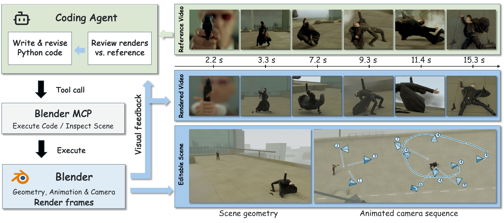

<p align="center">
  
</p>

<h1 align="center">CineRecon: Benchmarking Frontier Models<br>for Agentic Cinematic Reconstruction</h1>

<!-- arXiv and Hugging Face links are pending. -->
<p align="center">
  
  &nbsp;
  <a href="https://cinerecon.github.io/">
    
  </a>
  &nbsp;
  
</p>



**Figure 1. CineRecon task overview.** Given a complete reference video, an agent writes and revises Python code through Blender MCP, compares rendered frames with the reference, and reconstructs an editable dynamic scene. The Opus 5.5 Detailed example shows aligned reference and rendered frames, scene geometry, and the animated camera sequence. Camera labels indicate shot order.

CineRecon provides reference videos, annotations, reconstruction prompts, and tools for evaluating rendered reconstruction videos. All annotations and prompts are in English.

## Included

- 50 reference videos and 360 evaluation clips defined by frame intervals.
- 360 annotation files containing 35,836 distinct checklist records, or 49,668 checks expanded over L1/L2/L3.
- Reference entity tables, identity context, evidence frames, and source-video checksums.
- Judging instructions for Proxy (L1), Simplified (L2), and Detailed (L3).
- Reconstruction prompt templates and a description of the three representation settings.
- Frame selection, timestamp alignment, single-call judging, concurrent execution, resumption, and score aggregation.

For the generation task, prompt placeholders, representation requirements, refinement instructions, and expected deliverables, see [generation prompts and settings](docs/GENERATION.md). The document also describes the [Blender MCP connection and runtime settings](docs/GENERATION.md#blender-mcp-and-runtime-settings), including worker isolation, timeouts, and rendering. Agent launchers are not included.

## Install and verify

Use Python 3.10 or newer on Linux or macOS. Run from this directory; data remain in the checkout rather than inside the Python wheel.

```bash
python -m venv .venv
source .venv/bin/activate
python -m pip install -e .
python -m cinerecon validate --media
python examples/offline_smoke.py --output /tmp/cinerecon-smoke
python -m unittest discover -s tests -v
```

The offline example tests the workflow with a synthetic video and synthetic labels, without API calls. Use an empty output directory.

## Evaluate a reconstruction

The example below evaluates one selected clip. Pass the complete reconstruction video to `--generated`; the tool extracts the corresponding interval automatically.

```bash
python -m cinerecon prepare \
  --clip video1_cp001 --level L1 \
  --reference media/reference/video1.mp4 \
  --generated /path/to/reconstruction.mp4 \
  --configuration my_model_high --output runs/evaluation/video1_L1_cp001

# Preview locally without contacting a model service.
python -m cinerecon judge --job runs/evaluation/video1_L1_cp001

# Enter your OpenRouter API key (input is hidden).
read -s CINERECON_API_KEY
export CINERECON_API_KEY
python -m cinerecon judge --job runs/evaluation/video1_L1_cp001 --execute
python -m cinerecon summarize --jobs-root runs/evaluation --output runs/summary.json
```

The default route is OpenRouter at `https://openrouter.ai/api/v1/chat/completions`, using `openai/gpt-5.6-sol` with high reasoning effort, strict structured output, and streaming disabled. Requests are pinned to the OpenAI provider with fallbacks disabled and parameter support required. The key is read from `CINERECON_API_KEY` and is never saved.

Each request evaluates one clip under one setting using annotations and prompts, and saves the parsed ratings and run metadata.

You can evaluate a single setting. For example, an L2-only run reports the available L2 dimension and category scores, while the configuration-wide overall score across L1/L2/L3 is `null`. A setting's overall score requires all three dimensions; a configuration-wide overall score requires all three setting scores. Missing, failed, refused, and absent-dimension values are never zero-filled.

## Batch evaluation

Prepare your complete reconstruction videos and specify their paths in the cases file. Videos may be stored anywhere and may have any filename. No manual clipping or alignment is needed: the evaluator automatically extracts frames at the corresponding times for each evaluation clip.

Create a cases file using `configs/cases.example.json` as a template:

```json
{
  "cases": [
    {
      "configuration": "my_model_high",
      "level": "L2",
      "video_id": "video10",
      "generated": "/path/to/video10/reconstruction.mp4"
    }
  ]
}
```

Each entry identifies one complete reconstruction video:

| Field | Meaning |
|---|---|
| `configuration` | A name for the model and experimental settings that produced the video, used to group results (e.g., `my_model_high`); use letters, digits, underscores, or hyphens. It does not change the judge model or API settings |
| `level` | Representation setting: `L1`, `L2`, or `L3` |
| `video_id` | Reference-video identifier in the dataset manifest |
| `generated` | Path to the complete generated video; absolute paths are accepted, and relative paths resolve from the cases file's directory |

Add one entry for each model configuration, setting, and reference video you want to evaluate. Each combination must appear only once. You do not need to cut videos into clips or list individual clips. `prepare-batch` looks up every annotated clip for each reference video and prepares aligned frame pairs and the applicable checklist for each clip. Preparation is local and makes no model requests.

After setting `CINERECON_API_KEY` as shown above, run:

```bash
python -m cinerecon prepare-batch --cases configs/cases.example.json --output runs/evaluation
python -m cinerecon judge --jobs-root runs/evaluation --workers 8 --rpm 20 --execute
python -m cinerecon summarize --jobs-root runs/evaluation --output runs/summary.json
```

Replace `configs/cases.example.json` with your cases file. Prepared jobs and their results are organized under `runs/evaluation/<configuration>/<level>/<clip_id>/`. The `judge` command sends one separate API request per clip, using up to **8 concurrent workers** and starting at most **20 requests per minute** by default within one process. Adjust these limits with `--workers` and `--rpm`; this is client-side concurrency, not the provider's asynchronous Batch API. Omit `--execute` to preview requests locally.

Each completed request is saved separately. To resume, rerun the same `judge` command with the same inputs and settings; successful jobs are skipped. Add `--retry-failed` to retry failed or interrupted requests. Content safety refusals are not retried by this option. When changing a reconstruction video or judge settings, prepare jobs in a new output directory. The evaluator checks request fingerprints and image hashes before reusing results. Preparation failures are recorded in `preparation_report.json`; missing and failed results are reported separately and never counted as zero scores.

The summary reports L1/L2/L3 scores and valid clip/video counts for each configuration, with three dimension scores and an 11-category breakdown. Each category includes its score, contributing clip count, and scored item count. Missing categories have a `null` score. See [aggregation details](docs/EVALUATION.md#parsing-and-aggregation).

Keep credentials in the environment. Do not put real API keys in cases files, source code, documentation, or committed files. Local `.env` files are excluded by `.gitignore` but are not automatically loaded by the evaluator.

## Directory guide

| Directory | Contents |
|---|---|
| `data/` | Dataset manifest, schema, and annotations |
| `media/reference/` | Reference videos; see [media availability](docs/DATASET.md#reference-media) |
| `prompts/evaluation/en/` | Judge instructions for the three settings |
| `prompts/reconstruction/en/` | Reconstruction prompt templates for L1/L2/L3 |
| `configs/` | A reference record of default evaluator settings and a cases-file example |
| `cinerecon/` | Preparation, judging, and aggregation code |
| `tests/`, `examples/` | Regression tests and an offline demonstration |

`configs/evaluator.json` records the default evaluation settings; the CLI does not automatically load this file. Set concurrency and request rate with `--workers` and `--rpm`.

See [dataset specification](docs/DATASET.md), [generation prompts and settings](docs/GENERATION.md), and [evaluation protocol](docs/EVALUATION.md).

## License

Project-authored code, documentation, prompts, and annotations are released under the [MIT License](LICENSE). Third-party media, including reference frames reproduced in figures, retain their original rights.

### Reference video rights

Reference videos are excluded from the MIT License. Copyright remains with the respective rights holders. Their use and redistribution are subject to the applicable licenses and permissions.
